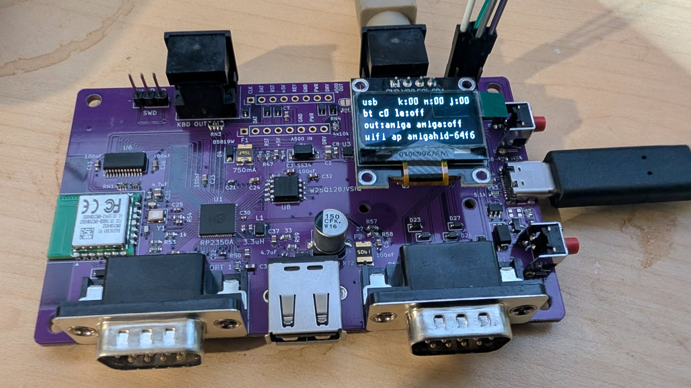

# Ninepin UX

A USB and Bluetooth HID bridge for retro computers. USB and Bluetooth keyboards, mice and game
controllers on a Commodore Amiga or a C64, with the real Amiga keyboard passed through alongside
them. Over Wi-Fi, a PiKVM-compatible API lets scripts and LLM agents type and move the mouse.
Over USB-C the board is a USB adapter for a PC, a Mac or a C64 Ultimate.

Originally based on [borb/amigahid-pico](https://github.com/borb/amigahid-pico).

## boards

| board | what | state |
|---|---|---|
| **rev7.1** (`hardware/rev7.1/`) | rev7 + a reset supervisor on RUN (cold-plug fix) | current design, ordered |
| rev7 (tag `hw/ux-rev7`) | RP2350A + RM2 radio chip-down, 4 layers, 100 x 62 mm | built; needs the RUN bodge ([errata](./doc/errata.md)) |

rev7 and rev7.1 run the same firmware and fit the same case. Older boards: [history](./doc/history.md).

## features

* **Keyboard out** to the Amiga: mini-DIN6 (A4000D); DIN5 machines (A2000, A3000, A4000T) through
  a DIN5-to-mini-DIN6 cable; A500 header.
* **Real Amiga keyboard in** (mini-DIN6 or A500 header), merged with USB and Bluetooth input.
  Ctrl-Amiga-Amiga resets the Amiga for as long as it is held.
* **USB host** (USB-A, hubs): keyboards, mice, game controllers.
* **Bluetooth** (RM2 / CYW43439): Classic and LE keyboards, mice and controllers.
* **Game controllers:** PS5 DualSense (USB, Bluetooth), PS4 DualShock 4 (Bluetooth), PS3
  DualShock 3 (USB), generic HID pads. Two players, swap, merge, deadzone, autofire, DualSense
  touchpad as mouse.
* **Pad combos and profiles:** a pad button stands for directions and fire held together, a
  keyboard key, or both; 32 named profiles, each for the Amiga, the C64 or both, switched from
  the page, the menu or the pad.
* **Three modes:** `amiga` (keyboards to the Amiga, mouse and pads to the DE9 ports), `c64`
  (keyboard and mouse to USB-C, pads to the DE9 ports), `usb` (everything, the Amiga keyboard
  included, to USB-C for a PC or Mac).
* **DE9 ports, Amiga:** mouse (TankMouse / Cocolino wheel), joystick with 3 fire buttons, CD32 pad.
* **DE9 ports, C64:** joystick with 2nd / 3rd fire on the POT lines, 1351 mouse.
* **USB-C device:** keyboard, mouse, two gamepads, serial console.
* **Keyboard settings:** Help / Del / ISO key mapping, Y-Z and AZERTY presets, 8 remaps each way.
* **Menu** on the OLED, in two levels, from a keyboard, the BOOT button, a rotary encoder, a
  PlayStation pad or the console.
* **Wi-Fi:** access point or joins a network; settings page (no JavaScript) with every menu
  setting, a log-in with the page password, the board's uptime and why it last restarted.
* **Network control:** a subset of the PiKVM `kvmd` HTTP API (keys, text in six keymaps, mouse).
* **Firmware updates:** A/B slots with rollback; from the latest signed release on GitHub when
  asked, or a file uploaded on the settings page; with or without a press of BOOT on the board.

## docs

* [user guide](./doc/user-guide.md): connecting, first install, modes, menu, pads, Bluetooth,
  Wi-Fi, network control, updates.
* [board](./doc/board.md): connectors, power, encoder, OLED.
* [build](./doc/build.md): firmware build, ordering and assembling a board, the case.
* [errata](./doc/errata.md): read before building.
* [history](./doc/history.md): earlier boards and where their files are.

Firmware downloads: [Releases](https://github.com/jusii/ninepin-ux/releases).

## repository

| path | what |
|---|---|
| `firmware/` | firmware source, CMake build, pico-sdk and library submodules |
| `hardware/rev7.1/` | KiCad project and generator scripts, `fab/` (JLCPCB package), `bom/` (hand-fit parts, ibom) |
| `hardware/case/` | 3D-printable case (STL, STEP, FreeCAD) and its generator |
| `tools/` | board checkers, bench scripts |
| `doc/` | the guides above |

## credits

* **nine (borb)**: the original [amigahid](https://github.com/borb/amigahid) and
  [amigahid-pico](https://github.com/borb/amigahid-pico): the idea, the Amiga keyboard and
  quadrature code, the rev 2-5 boards.
* **Stefan Reinauer**: Bluetooth HID host, mouse-motion rewrite, input bridge, SDK/TinyUSB/CYW43
  update ([#44](https://github.com/borb/amigahid-pico/pull/44),
  [#47](https://github.com/borb/amigahid-pico/pull/47),
  [#48](https://github.com/borb/amigahid-pico/pull/48),
  [#49](https://github.com/borb/amigahid-pico/pull/49)). The settings store, gamepad parser, PS3,
  DualShock 4, CD32 and menu input handling are ported from his
  [reinauer/amigahid-pico](https://github.com/reinauer/amigahid-pico).
* **fboldog**: SH1106 1.3" OLED support ([#46](https://github.com/borb/amigahid-pico/pull/46)).
* **BennehBoy**, **rfuest**: keyboard fixes upstream.
* µgui by Achim Döbler, see the [display readme](./firmware/src/display/README.md).

An LLM assistant was used throughout this project, for the board layout, the checker scripts,
the firmware and these docs. Every result was reviewed, built and tested by hand.

## license

* Firmware and tools: Eclipse Public License 2.0 ([LICENSE](./LICENSE)), inherited from upstream.
* Hardware (`hardware/`: boards and case): CERN-OHL-W-2.0 ([hardware/LICENSE](./hardware/LICENSE)).

Jusii: boards, case, keyboard passthrough, rev7 firmware.
