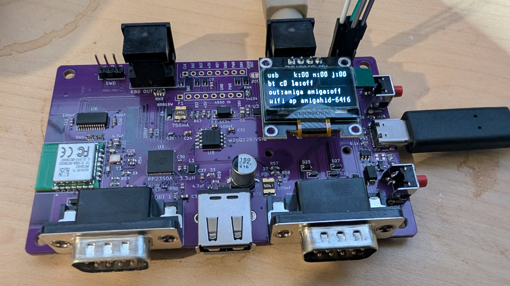

# Ninepin UX board (rev7.1)

RP2350A and RM2 (CYW43439) radio chip-down, 16 MB flash, 4 layers, 100 x 62 mm, four M3 holes.
Sources in [`hardware/rev7.1/`](../hardware/rev7.1/). Using it: [user guide](./user-guide.md).
Building one: [build](./build.md). Read the [errata](./errata.md) first.

rev7.1 is rev7 plus U11, a TLV803S reset supervisor on RUN; everything below holds for both.

## connectors

| ref | what | pins / note |
|---|---|---|
| J10 | KBD OUT, mini-DIN6, to the Amiga (A4000) | PS/2 positions: 1 DAT, 3 GND, 4 +5V, 5 CLK |
| J12 | KBD IN, mini-DIN6, from the Amiga keyboard | same pinout |
| J1 | A500 KBD OUT header, 1x8 | CLK DAT RST +5V KEY GND PWR DRV |
| J8 | A500 KBD IN header, 1x8 | same order; pin 5 is the key |
| P1 / P2 | DE9 male, controller ports 1 / 2 | straight-through F-F cable to the Amiga, not null-modem |
| J4 | USB-A host | keyboards, mice, pads, hubs; 500 mA polyfuse F2 |
| J13 | USB-C | power and USB device: keyboard, mouse, 2 gamepads, serial console |
| J3 | OLED socket, 1x4 | GND VCC SCL SDA |
| J7 | encoder header, 2x3 | 1 SW, 2 spare, 3 B, 4 GND, 5 A, 6 +3V3 |
| J2 | SWD, 1x3 | SWCLK GND SWDIO |
| SW1 / SW2 | BOOT / RESET | right-angle, east edge |
| JP1 | solder jumper | bridge to light an A500 keyboard's power LED |

## power

Either source runs the board:

* Amiga keyboard connector or A500 header: `AMIGA_5V -> F1 (750 mA) -> D1 -> SYS5V`.
* USB-C: `-> D2 -> SYS5V`.

SYS5V feeds a 3.3 V regulator (RP2350, RM2, flash, OLED, I/O expander) and the USB-A port
(F2, 500 mA). The keyboard input port has its own 500 mA fuse (F3). U11 holds RUN low until 3V3
has been above 2.93 V for 200 ms.

Amiga-facing lines go through bus switches on their own rail, diode-OR'd from the keyboard
connector's 5 V and DE9 pin 7 of each port. The ports work with only the DE9 cables connected
(A600/A1200), DE9 5 V never powers the board, and a USB-C-powered board never back-feeds an
Amiga that is off.

## encoder (optional)

Any EC11 encoder with push switch. Wire A to pin 5, B to pin 3, switch to pin 1, and both
encoder ground pins (A/B common and switch) to pin 4. Pin 6 (3V3) stays free unless you add
external pull-ups; the I/O expander has internal ones. Wrong turning direction: swap A and B.

## OLED

0.96" SSD1306 128x64 I2C module, for example
[this AliExpress listing](https://www.aliexpress.com/item/1005011855265244.html). The drawing on
that page is wrong; measured:

* PCB 26.0 x 26.0 mm, mounting holes 22.2 x 22.2 mm (1.9 mm from the edges).
* Header GND VCC SCL SDA. Check your module's silk before soldering the socket.
* Mount on 11 mm M2 posts over an 8.5 mm socket. **Nylon posts, screws and nuts only**: copper
  runs 0.2 mm from the post holes.

A 1.3" SH1106 module works with a firmware built for it ([build](./build.md#options)).
