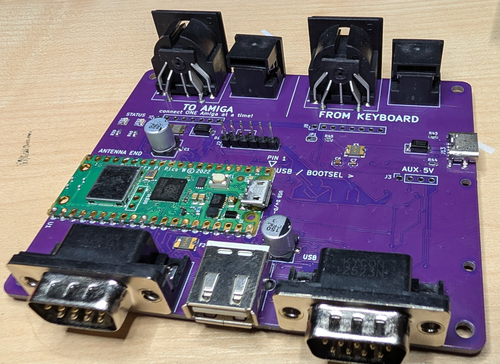
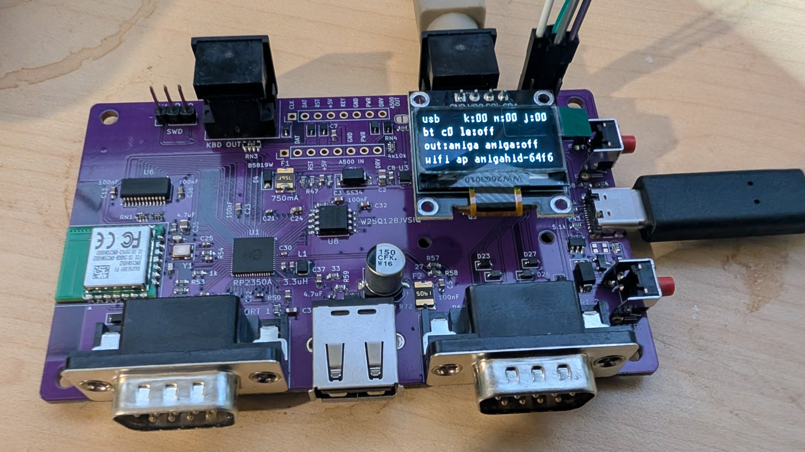

# History

Earlier boards left the tree but stay in git. Check out the tag to get a board's files, docs and
firmware: `git checkout <tag>`.

| board | what | files | firmware |
|---|---|---|---|
| upstream rev 1-5 (borb) | Pico module carrier, BSS138 shifters, A500 header | rev5 only: tag `hw/upstream-rev5`, `kicad/amigahid-pico.*` | tag `hw/ux-rev7`, `BOARD_TYPE=BOARD_HIDPICO_REV2` / `REV4` (rev4 and rev5) |
| UX rev 1 (internal rev6) | carrier for a Pico W / Pico 2 W, DIN5 and mini-DIN6 sockets, 2 layers | tag `hw/ux-rev1`, `kicad/rev6/`, `doc/ux-rev1.md` | tag `hw/ux-rev7`, `BOARD_TYPE=BOARD_HIDPICO_REV6` |
| UX rev7 | RP2350A + RM2 chip-down, 4 layers | tag `hw/ux-rev7`, `kicad/rev7/` | current `master` |
| rev7.1 | rev7 + RUN supervisor | `hardware/rev7.1/` | current `master` |

Upstream's own history: [borb/amigahid-pico](https://github.com/borb/amigahid-pico). The real
Amiga keyboard on controller port 2 of a rev4 / rev5 board (`PORT2_ROLE=KEYBOARD`):
[jusii/amigahid-pico-UX](https://github.com/jusii/amigahid-pico-UX), branch `port2-real-keyboard`.

| | |
|---|---|
|  | upstream rev 1 |
|  | upstream rev 2 |
|  | upstream rev 4 |
|  | upstream rev 5 |
|  | UX rev 1 |
|  | UX rev7 |
